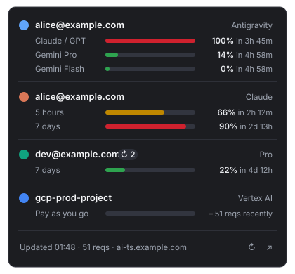

# cpa-quota-view

[](https://github.com/ahmed-khaire/cpa-quota-view/actions/workflows/ci.yml)

A lightweight desktop tray applet and CLI/JSON quota viewer for [CLIProxyAPI](https://github.com/router-for-me/CLIProxyAPI) that works against **any stock CLIProxyAPI instance** — local or remote (Docker, Swarm, Tailscale) — **without installing a server-side plugin**.



## How It Works Without a Plugin

Unlike native Go plugins such as [`cpa-quota-api-extension`](https://github.com/ahmed-khaire/cpa-quota-api-extension), `cpa-quota-view` does not require `CGO_ENABLED=1`, `plugins.enabled: true`, or recompiling a `.so` whenever CLIProxyAPI updates (e.g. daily `:latest` Docker upgrades).

Instead, it uses two endpoints already built into every stock CLIProxyAPI Management API:

```text
cpa-quota-view (GTK tray / --print / --json / --waybar / --watch)
        │
        │ HTTPS + MANAGEMENT_KEY (from env or 1Password CLI)
        ▼
CLIProxyAPI /v0/management
  ├── GET  /auth-files   → lists accounts, providers, auth_index, project_id, id_token, cooldowns, passive signals
  └── POST /api-call     → server-side authenticated relay (substitutes $TOKEN$ with live OAuth token)
        │
        ├── Anthropic   api.anthropic.com/api/oauth/usage
        ├── OpenAI      chatgpt.com/backend-api/wham/usage (+ rate-limit-reset-credits)
        ├── Antigravity daily-cloudcode-pa.googleapis.com/v1internal:fetchAvailableModels
        ├── Gemini CLI  cloudcode-pa.googleapis.com/v1internal:retrieveUserQuota
        ├── xAI         cli-chat-proxy.grok.com/v1/billing
        └── Kimi        api.kimi.com/coding/v1/usages
```

**Why this is safe & portable:**
- **Zero OAuth token exposure:** `cpa-quota-view` sends `"Authorization": "Bearer $TOKEN$"` inside `/v0/management/api-call`. CLIProxyAPI replaces `$TOKEN$` server-side (auto-refreshing expired OAuth tokens) and returns only the upstream response.
- **Zero local state required:** Codex's `Chatgpt-Account-Id` header is decoded directly from the `id_token` returned by `/v0/management/auth-files`, so the viewer works against remote Docker/Swarm hosts with no access to `oauth/` on disk.
- **Survives core upgrades:** Uses the stable Management API instead of Go plugin ABI bindings, so it keeps working across stock `eceasy/cli-proxy-api:latest` upgrades.

### When to Use `cpa-quota-view` vs `cpa-quota-api-extension`

| | `cpa-quota-view` (this repo) | `cpa-quota-api-extension` (Go plugin) |
| --- | --- | --- |
| **Server changes** | None (works on stock Docker `:latest`) | Requires CGO-enabled build + `plugins.enabled: true` |
| **Best for** | Linux desktop tray, notifications, Waybar/tmux, CLI/JSON scripts | Shared server-side JSON API for Homepage, Grafana, Home Assistant |
| **Caching & history** | Local disk snapshot cache (`--max-age` / `--cached`) | Server-side 30 min cache, SQLite incident history, webhooks |
| **Providers** | Claude, Codex, Antigravity, Gemini CLI, xAI, Kimi, Vertex AI | Codex, Gemini CLI, Antigravity, Claude |

## Features

- **All 7 providers:**
  - **Claude OAuth:** 5h / 7d windows, model-scoped weekly limits (e.g. Fable), extra credits, plus automatic fallback to passive `quota.signals` if `/api/oauth/usage` is rate-limited.
  - **Codex (ChatGPT):** 5h / 7d windows, additional model rate limits, credit balance, and manual reset credit count/expiry badge.
  - **Antigravity:** Live per-family quota (`Claude / GPT`, `Gemini Pro`, `Gemini Flash`) with exhausted-bucket detection and per-model hover tooltips.
  - **Gemini CLI:** Per-family quota buckets via `retrieveUserQuota`.
  - **xAI (Grok)** & **Kimi:** Usage windows and billing/reset countdowns.
  - **Vertex AI:** Pay-as-you-go status with recent request counts.
- **Desktop tray & notifications:**
  - Single-instance Unix control socket (re-launching `--panel` toggles the existing popup instead of duplicating the tray icon; `--refresh` triggers an immediate reload).
  - X11 `Gtk.StatusIcon` with automatic Wayland `AyatanaAppIndicator3` fallback.
  - Instant startup from disk cache (`~/.cache/quota-view/snapshot.json`).
  - Inline active cooldown & account error warnings.
  - Debounced desktop notifications via `notify-send` on threshold crossings (`80%`, `100%`), account errors, and quota resets (toggleable from the tray menu).
- **Headless CLI & status-bar modes** (zero GTK required):
  - `--print`, `--json`, `--short`, `--waybar`, `--watch [SECS]`, `--provider`, `--cached` / `--max-age`, and `--fail-above <PCT>` (exit code `2` for cron/CI alerts).

## Configuration

Create `~/.config/quota-view.json` (no secrets stored on disk when using a secret manager command such as 1Password CLI):

```json
{
  "theme": "system",
  "base_url": "https://ai-ts.example.com",
  "mgmt_key_cmd": ["op", "read", "op://Work/swarm-cpa/MANAGEMENT_KEY"],
  "refresh_sec": 300,
  "notifications": true,
  "notify_thresholds": [80, 100],
  "tray_backend": "auto"
}
```

Or configure via environment variables:

| Variable | Description |
| --- | --- |
| `CPA_BASE_URL` | CLIProxyAPI base URL (default: `http://127.0.0.1:8317`) |
| `CPA_MANAGEMENT_KEY` | Management key directly (overrides `mgmt_key_cmd`) |
| `CPA_MANAGEMENT_KEY_CMD` | Shell command that prints the management key |
| `CPA_CONFIG_PATH` | Optional fallback path to a local `config.yaml` or `config.toml` |
| `CPA_REFRESH_SEC` | Tray auto-refresh interval in seconds (default: `300`, min `30`) |

## Usage

```bash
# Terminal summary (headless — no GTK required)
python3 quota_view.py --print

# Reuse local cache if fresher than 120s (avoids rate-limiting upstream usage APIs)
python3 quota_view.py --print --max-age 120

# Sanitized JSON snapshot (filtered by provider)
python3 quota_view.py --json --provider claude,antigravity

# Compact one-liner for tmux / shell prompt
python3 quota_view.py --short --cached

# Waybar custom module JSON
python3 quota_view.py --waybar --max-age 120

# Live terminal watcher (every 60s)
python3 quota_view.py --watch 60

# Alerting / cron check (exits 2 if any Claude window >= 90%)
python3 quota_view.py --provider claude --cached --fail-above 90

# Launch or toggle the GNOME / GTK tray applet
python3 quota_view.py --panel

# Trigger a live refresh on the running tray applet
python3 quota_view.py --refresh
```

## Install (Ubuntu / GNOME + systemd)

Requires Python 3 and (for the tray GUI) `python3-gi`, `python3-cairo`, `gir1.2-gtk-3.0`, and optionally `gir1.2-ayatanaappindicator3-0.1` (for Wayland) and `libnotify-bin` (for desktop notifications):

```bash
./install.sh
```

This installs the symbolic provider icons (`icons/qv-*-symbolic.svg`), the `.desktop` launcher, and enables `quota-view.service` as a user systemd unit.

## Tests

```bash
python3 -m unittest discover -s tests -v
```
